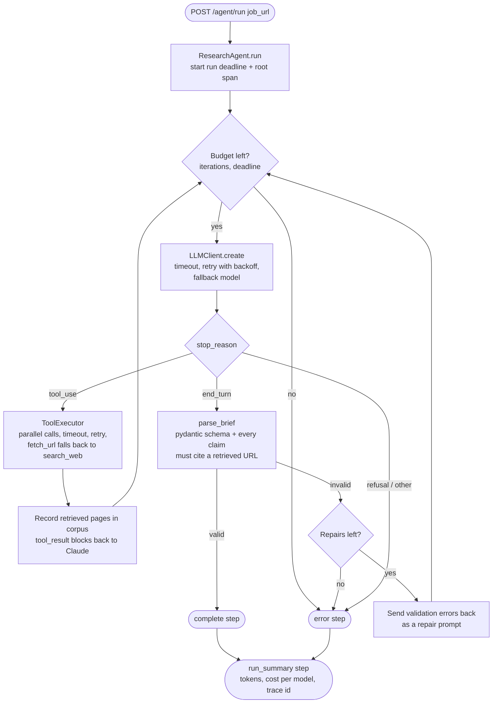

# AI Research Agent

A FastAPI service that takes a job posting URL, researches the role and the company with a Claude tool-use loop (page fetch + web search), and returns a structured research brief in which every factual claim cites the page it came from.

It is built to show the parts of an agent that matter after the demo works: tracing every step, surviving flaky tools and APIs, refusing to emit unvalidated output, and measuring whether the answer is actually grounded in its sources.


## The problem

Wiring a model to a search API takes an afternoon. Running it unattended is harder:

- **Loops and runaways.** A model that keeps asking for "one more search" burns tokens until something stops it.
- **Flaky dependencies.** Job boards block scrapers, search APIs rate-limit, the model API returns 529 Overloaded. A single failure should not lose the whole run.
- **Unparseable or invalid output.** "Return only JSON" is a request, not a guarantee.
- **Plausible but ungrounded answers.** The most damaging failure is a confident claim citing a page the agent never read, or a real page that does not say what the claim says.
- **No visibility.** Without traces you cannot tell which turn was slow, which tool failed, or what a run cost.

This repo addresses each one and measures the result.

## How it works



Each run streams newline-delimited JSON steps (`tool_call`, `tool_result`, `repair`, `complete` or `error`, then `run_summary`), so a frontend can render progress live.

The brief schema (`agent/models.py`) carries the usual fields (role, company, tech stack, requirements, talking points, red flags, sources) plus `claims`: each one a `statement`, the `source` URL and a verbatim `quote` from that page.

## Example run

`python -m agent <job_url>` runs the real agent from the terminal. To see the same output without API keys, `python -m evals.demo` runs a scripted session through the real retry, validation and tracing code: the first LLM call gets a 529, the first page fetch a 503, and the first brief is missing a field.

```
$ python -m evals.demo
[tool_call] Calling fetch_url: https://example.com/job/123
[tool_result] fetch_url returned 228 characters
[tool_call] Calling search_web: Example Co company overview funding 2025
[tool_result] search_web returned 425 characters
[repair] Brief failed validation, asking for a fix (1/2)
[complete] Research complete: Senior Backend Engineer at Example Co
[run_summary] complete: 4 LLM calls, 2 tool calls, $0.1240
```

The `run_summary` step (also the last line of the API stream):

```json
{
  "status": "complete",
  "trace_id": "248ff4b4d87525a1b62ab2de265ce72e",
  "llm_calls": 4,
  "llm_retries": 1,
  "tool_calls": 2,
  "tool_retries": 1,
  "repairs": 1,
  "models_used": ["claude-opus-5-5"],
  "fell_back": false,
  "sources_retrieved": 3,
  "usage": {
    "input_tokens": 18400,
    "output_tokens": 2520,
    "cost_usd": 0.124,
    "by_model": {
      "claude-opus-5-5": {"calls": 4, "input_tokens": 18400, "output_tokens": 2520,
                          "cache_read_tokens": 0, "cache_write_tokens": 0, "cost_usd": 0.124}
    }
  }
}
```

Trace excerpt from the default console exporter, printed when the run ends:

```
trace 248ff4b4d87525a1b62ab2de265ce72e
  invoke_agent research-agent  3ms  status=complete in=18400 out=2520 cost$=0.1240
    agent.step  1ms  #=1 kind=research
      chat claude-opus-5-5  0ms  model=claude-opus-5-5 stop=tool_use in=2400 out=160 cost$=0.0128 attempts=2 events=retry
      execute_tool fetch_url  0ms  tool=fetch_url attempts=2 events=retry
    agent.step  1ms  #=2 kind=research
      chat claude-opus-5-5  0ms  model=claude-opus-5-5 stop=tool_use in=2400 out=160 cost$=0.0128 attempts=1
      execute_tool search_web  0ms  tool=search_web attempts=1
    agent.step  1ms  #=3 kind=research
      chat claude-opus-5-5  0ms  model=claude-opus-5-5 stop=end_turn in=6800 out=1100 cost$=0.0492 attempts=1
      agent.validate_brief  0ms  valid=False
    agent.step  1ms  #=4 kind=repair
      chat claude-opus-5-5  0ms  model=claude-opus-5-5 stop=end_turn in=6800 out=1100 cost$=0.0492 attempts=1
      agent.validate_brief  0ms  valid=True
```

The responses, token counts and durations here are scripted (nothing goes over the network). A live run produces the same shape with real latency and real usage.

## Tracing

`agent/telemetry.py` sets up OpenTelemetry. Every run is one trace:

| Span | Kind | Key attributes |
|---|---|---|
| `invoke_agent research-agent` | root | `agent.status`, `agent.llm_calls`, `agent.llm_retries`, `agent.tool_calls`, `agent.repairs`, `agent.models_used`, `gen_ai.usage.input_tokens/output_tokens`, `agent.cost_usd`, `agent.cost_usd.<model>` |
| `agent.step` | one per LLM turn | `agent.iteration`, `agent.step.kind` (research or repair), `agent.stop_reason` |
| `chat <model>` | client | `gen_ai.request.model`, `gen_ai.response.model`, `gen_ai.usage.*` (incl. cache read/creation), `gen_ai.response.finish_reasons`, `llm.attempts`, `llm.cost_usd`; `retry` and `model_fallback` events |
| `execute_tool <name>` | one per tool call | `gen_ai.tool.name`, `gen_ai.tool.call.id`, `tool.attempts`, `tool.fallback`, `tool.error`; `retry` and `tool_fallback` events |
| `agent.validate_brief` | | `agent.brief_valid`, `agent.claims`, `agent.validation_problems` |

Attribute names follow the OpenTelemetry GenAI semantic conventions, so backends that understand them show model, token and tool details without mapping. Prompts and page contents are not exported, only metadata.

Pick the destination with `TRACING_EXPORTER` (comma-separate to combine, e.g. `console,langfuse`):

| Value | Destination | Needs |
|---|---|---|
| `console` (default) | indented span tree on stdout | nothing |
| `console_json` | stock OpenTelemetry JSON per span | nothing |
| `otlp` | any OTLP/HTTP backend (Jaeger, Grafana, Honeycomb, ...) | standard `OTEL_EXPORTER_OTLP_*` variables |
| `langfuse` | Langfuse OTLP endpoint | `LANGFUSE_PUBLIC_KEY`, `LANGFUSE_SECRET_KEY`, `LANGFUSE_HOST` |
| `langsmith` | LangSmith OTLP endpoint | `LANGSMITH_API_KEY`, `LANGSMITH_PROJECT`, `LANGSMITH_ENDPOINT` |
| `none` | off | |

Langfuse and LangSmith are reached through their OTLP endpoints, so there is no vendor SDK in the dependency tree and switching backends is a config change.

## Reliability

| Failure | Handling | Where |
|---|---|---|
| LLM 429, 5xx, 529 Overloaded, connection error, timeout | Retry with exponential backoff and full jitter (`LLM_MAX_ATTEMPTS`). SDK retries are off so every retry is counted and traced. | `agent/llm.py` |
| Primary model stays unavailable | Switch the run to `FALLBACK_MODEL` and stay there for the rest of the run | `agent/llm.py` |
| Safety classifier declines | Server-side refusal fallback (beta) on models that support it; otherwise a clean `error` step | `agent/llm.py`, `agent/orchestrator.py` |
| Tool network error, 429/5xx, timeout | Retry with backoff (`TOOL_MAX_ATTEMPTS`), per-call `TOOL_TIMEOUT_SECONDS` | `agent/tools.py` |
| Page blocked (403) or unreachable | `fetch_url` falls back to a web search for that URL and says so in its result | `agent/tools.py` |
| Tool fails completely | Returned to Claude as a `tool_result` with `is_error: true`, so it can try another source | `agent/tools.py` |
| Model never stops calling tools | `MAX_ITERATIONS` research turns | `agent/orchestrator.py` |
| Run takes too long | `RUN_TIMEOUT_SECONDS` deadline shared by every call; per-call timeouts are capped to the time left, and retries stop when the next backoff would overrun it | `agent/reliability.py` |
| Final answer is not valid JSON, misses fields, or cites URLs it never retrieved | Pydantic validation; the errors go back to Claude as a repair prompt, up to `MAX_REPAIR_ATTEMPTS` times. Repair turns do not consume the research budget. | `agent/output.py`, `agent/models.py` |
| URL points at localhost or a private IP | `fetch_url` refuses it | `agent/tools.py` |

## Cost per run

Every run reports its own cost in `run_summary`, broken down by model, using the per-token prices in `agent/pricing.py` (first-party API rates, cache reads and writes included).

For a sense of scale, the scripted token profile used by the mock suite (a 3-turn run: fetch the posting, one search, write the brief; 11,600 input and 1,420 output tokens) prices out as:

| Model | Input / output per 1M tokens | 3-turn run | Same run with one repair turn |
|---|---|---|---|
| `claude-opus-5-5` (default) | $4 / $20 | $0.0748 | $0.1240 |
| `claude-sonnet-5-5` (default fallback) | $2 / $10 | $0.0374 | $0.0620 |
| `claude-haiku-5-5` | $0.10 / $0.50 | $0.0019 | $0.0031 |
| `claude-fable-5-1` | $10 / $50 | $0.1870 | $0.3100 |

These are estimates from a scripted profile without prompt caching, not measurements. Real runs vary with page length, the number of searches and effort level; automatic prompt caching (on by default) bills the repeated prefix of later turns at the cache-read rate. The live eval suite records measured cost per run.

## Evals

`python -m evals.run_evals` runs 18 mocked cases with no network or keys. Claude's responses and tool outcomes are scripted, but they plug in below the reliability layer, so retries, timeouts, fallbacks, validation and repair all run for real.

Two grounding metrics are computed for every completed brief against the pages the run actually retrieved (`evals/grounding.py`):

- **Citation accuracy**: share of claims that cite a URL a tool call returned.
- **Groundedness**: share of claims whose cited page contains the quote verbatim (after normalisation), every number in the statement, and most of its content words.

Three calibration cases plant one bad claim each (fabricated quote, quote from a different page, inflated number) and pass only if the scorer flags exactly that claim for the right reason, so the metric itself is tested.

Current results (full table in [evals/RESULTS.md](evals/RESULTS.md)):

| Group | Cases | Result |
|---|---|---|
| Output parsing (clean, fenced, prose-wrapped JSON) | 3 | 3/3, all 100% cited and grounded |
| Validation and repair (exhausted, missing field, unretrieved citation) | 3 | 3/3 |
| Loop guards (max iterations, run timeout, unexpected stop, refusal) | 4 | 4/4 |
| LLM retry and model fallback | 2 | 2/2 |
| Tool retry, fetch-to-search fallback, tool timeout | 3 | 3/3 |
| Scorer calibration (fabricated quote, misattributed source, changed number) | 3 | 3/3, each flags 1 of 4 claims |

`python -m evals.run_evals --live` runs the real agent against current job postings and applies the same checks plus a groundedness threshold; `--judge` adds an LLM judge (`claude-haiku-5-5`, structured output) for whether each cited page supports its claim; `--write-md` regenerates `evals/RESULTS.md`. Live runs need `ANTHROPIC_API_KEY` and `TAVILY_API_KEY`. The raw report goes to `evals/results.json`, which is gitignored.

## Setup

Requires Python 3.11+.

```bash
python -m venv .venv
source .venv/bin/activate
pip install -r requirements-dev.txt
cp .env.example .env        # add ANTHROPIC_API_KEY and TAVILY_API_KEY
```

Run the API:

```bash
uvicorn main:app --reload
curl -N -X POST localhost:8000/agent/run \
  -H 'content-type: application/json' \
  -d '{"job_url": "https://example.com/jobs/123"}'
```

Or with Docker:

```bash
docker build -t ai-research-agent .
docker run --env-file .env -p 8000:8000 ai-research-agent
```

Checks (the same ones CI runs):

```bash
ruff check . && ruff format --check .
pytest -q                     # 91 tests, mocked LLM and tools
python -m evals.run_evals     # mock eval suite
```

All settings are environment variables; `.env.example` lists them with defaults.

## Project layout

```
agent/
  orchestrator.py   agent loop, run guards, repair, run summary, root/step spans
  llm.py            Claude client: timeout, retries, fallback model, chat spans
  tools.py          fetch_url and search_web, ToolExecutor (retry, timeout, fallback)
  output.py         JSON extraction, validation, grounding guard
  models.py         ResearchBrief, Claim, AgentStep
  reliability.py    RetryPolicy, Deadline, retry_async
  telemetry.py      OpenTelemetry setup and exporters
  pricing.py        model catalog and prices
  usage.py          per-run token and cost accounting
  prompts.py        system and repair prompts
evals/              mock and live suites, grounding scorer, LLM judge, demo
tests/              pytest suite
main.py             FastAPI app
```

## Tradeoffs and limitations

- **Hand-written loop over a framework.** The orchestrator is under 400 lines and every guard is visible and testable. A framework or the SDK's tool runner would be less code but would hide the retry, repair and tracing seams this project is about.
- **Prompted JSON plus validation and repair, not constrained decoding.** Structured outputs could guarantee the schema, but not the cross-field rules (claims must cite listed and retrieved sources), so validation and repair are needed anyway. Repair costs an extra turn when it triggers; the mock table shows that cost.
- **The grounding guard checks provenance, not truth.** The agent rejects a claim that cites a page it never retrieved. Whether the page supports the claim is measured by the evals, not enforced at runtime, because a strict quote match would reject reasonable paraphrases and burn repair turns.
- **The deterministic groundedness check is lenient about meaning.** It catches fabricated quotes, misattribution and changed numbers. A statement that reuses the source's words to say something different can pass; that is what the optional LLM judge is for. Claims the model leaves out of `claims` are not checked at all.
- **Fallback model trades quality for availability.** When the primary is overloaded the run continues on a cheaper model rather than failing. Set `FALLBACK_MODEL=` to disable.
- **Retries cost money.** Up to `LLM_MAX_ATTEMPTS` per turn. Every retry is a span event and counted in `run_summary`, so it is visible, not hidden.
- **Cost figures come from a local price table.** They make cost visible per run and per model; they are not a billing source. Check current prices before relying on them, and update `agent/pricing.py` when they change. With the server-side refusal fallback, a rescued turn is attributed to the model the API reports in the response.
- **The URL guard is not a full SSRF defence.** It blocks non-HTTP schemes and private or loopback IP literals but does not resolve DNS. Run the service without access to internal networks.
- **Mock evals test the harness, not the model.** They prove the loop, guards and scorer behave correctly. Answer quality comes from the live suite, which depends on whichever job postings are live that day.
